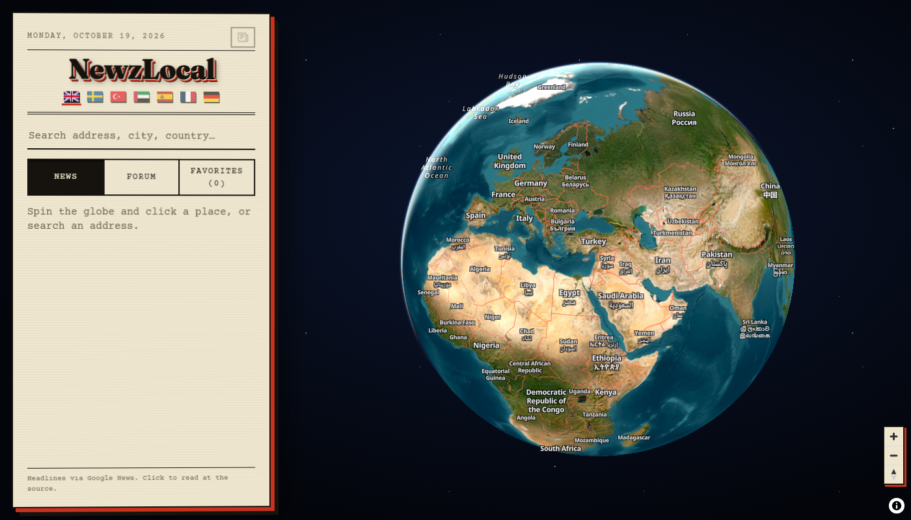
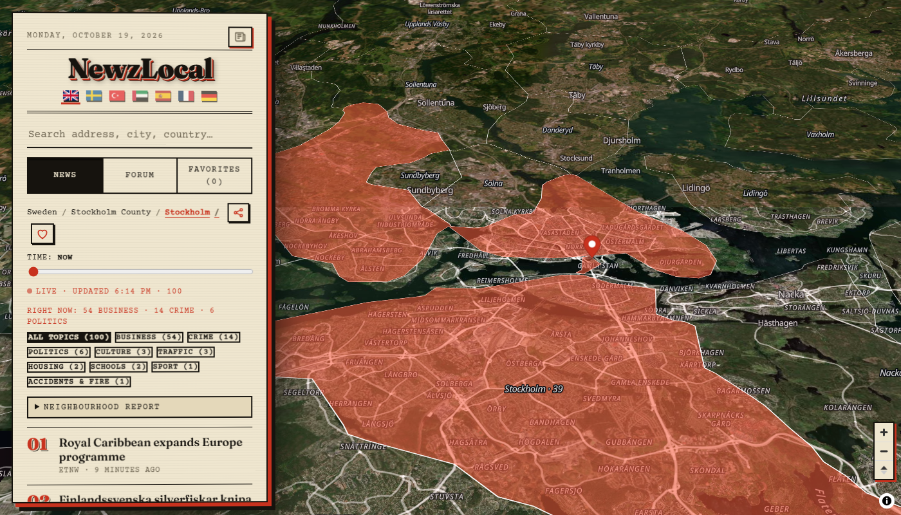

<div align="center">

# 🌍 NewzLocal

### Snurra jorden. Klicka på en plats. Läs vad som händer där, just nu.
*Spin the globe. Click anywhere. Read what's happening there, right now.*

[](LICENSE)




</div>

---

## ✨ Vad är NewzLocal?

NewzLocal är en **webbapp (PWA) med en riktig 3D-jord**. Du zoomar från hela världen ner till land → region → stad → stadsdel → **enskild gata**, och på varje nivå får du de senaste nyheterna och forumdiskussionerna om *exakt den platsen*. Allt i en tidningsdesign inspirerad av gamla pappersupplagor.

> Ingen konto-registrering. Inga spårare. Dina favoriter ligger bara i din egen webbläsare.

## 📸 Skärmbilder

<div align="center">

| Jorden | Lokala nyheter för Stockholm |
|:---:|:---:|
|  |  |

</div>

## 🚀 Funktioner

| | |
|---|---|
| 🌐 **Riktig 3D-jord** | Satellitbilder, atmosfär och 3D-byggnader med MapLibre. |
| 🔎 **Djup zoom** | Land → provins → distrikt → stadsdel → gata/adress, med gränser från OpenStreetMap och geoBoundaries. |
| 📰 **Exakta lokala nyheter** | Bara rubriker som faktiskt nämner platsen. Upp till 100 senaste, med adaptiv sökning över tid. |
| 💬 **Forum-flik** | Trådar från Flashback (Sverige), Reddit, Hacker News och Stack Exchange, sorterade på skapandedatum. |
| ⭐ **Favoriter & kategorier** | Spara platser, sortera i egna kategorier med dra-och-släpp. |
| 🔔 **Notiser & larm** | Nya nyheter per favorit, ämnesfilter och tysta timmar. |
| 🗞️ **Min tidning** | Alla dina favoriters nyheter på en gammaldags tidningsframsida du bläddrar i. |
| 🔥 **Nyhetsvärme** | Se på kartan vilka områden som har flest rubriker just nu. |
| ⏱️ **Tidsreglage** | Nu, 1, 3, 6 eller 12 månader bakåt. |
| ⇄ **Jämför platser** | Två favoriter sida vid sida. |
| 🏘️ **Grannskapsrapport** | Sammanfattning av vad som skrivs om ett område. |
| 🏷️ **Ämnen** | Brott, trafik, ekonomi, väder m.fl. – nyckelord på alla 7 språk. |
| 🔗 **Dela plats** | Skicka en länk som öppnar samma plats. |
| 📱 **Installerbar PWA** | Fungerar på mobil och desktop, med offline-kopia av senaste listan. |
| 🌐 **7 språk** | English, Svenska, Türkçe, العربية (RTL), Español, Français, Deutsch. Rubriker översätts automatiskt. |

## 🛠️ Teknik

- **React 19 + TypeScript + Vite**
- **MapLibre GL** (3D-glob, vektorkartor, 3D-byggnader)
- Datakällor: Google News RSS, Reddit, Hacker News (Algolia), Stack Exchange, Flashback, OpenStreetMap (Overpass, Nominatim, Photon), geoBoundaries
- Ingen backend i utvecklingsläge: Vite-proxy hanterar CORS

## ▶️ Kom igång

Krav: **Node.js 20+**

```bash
git clone https://github.com/nRn-World/NewzLocal.git
cd NewzLocal
npm install
npm run dev
```

Öppna sedan http://localhost:5173.

Bygg för produktion:

```bash
npm run build
npm run preview
```

> ⚠️ Nyhets- och forumkällorna hämtas via en dev-proxy (`/gn`, `/rd`, `/fb` i `vite.config.ts`). För en publik drift behövs en egen proxy (t.ex. en Cloudflare Worker), och källornas villkor måste följas.

## 🗺️ Planer

- Riktig push-notis när appen är stängd (server/Web Push)
- Inloggning och synk mellan enheter
- Android-app via Capacitor
- Byte till licensierade data- och bildkällor

## 📜 Licens

**NewzLocal Non-Commercial Educational License (NNEL)**. Kortversionen:

- ✅ Du får använda, ändra och dela koden för **personligt, utbildnings- och forskningsbruk**.
- ✅ Du **måste nämna "NewzLocal by nRnWorld"** i ditt projekts README/licens och i appens "Om"-del.
- ❌ Du får **inte sälja den, tjäna pengar på den, visa reklam i den eller bygga betaltjänster på den**.
- 💼 Vill du använda den kommersiellt? Kontakta oss först.

Läs hela texten i [LICENSE](LICENSE). Tredjepartstjänsterna har egna villkor som du själv ansvarar för.

---

<div align="center">

**Skapad av [nRnWorld](https://nrnworld.one)** · [Fler projekt](https://nrnworld.one) · [GitHub](https://github.com/nRn-World)

*Om du gillar projektet, ge det en ⭐*

</div>
